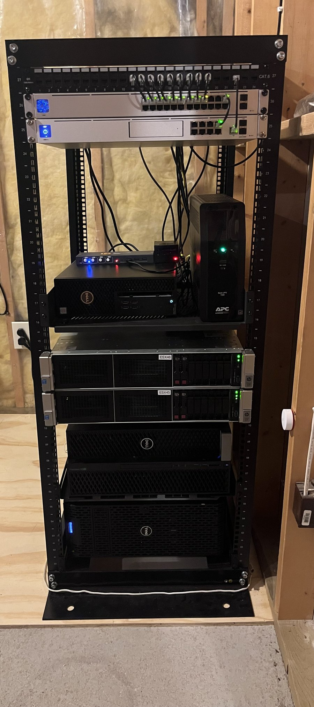
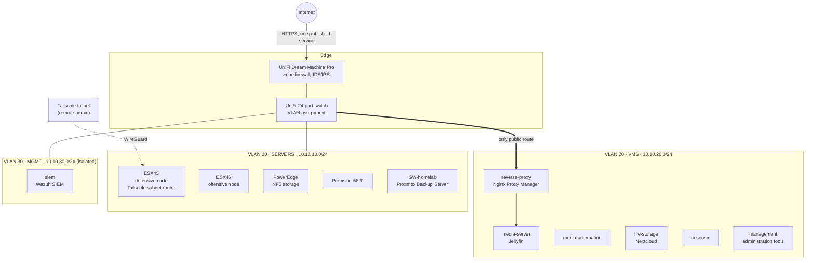

<h1 align="center">Homelab</h1>

A five-server Proxmox environment I designed, built, and secure myself. 
It runs real services every day and doubles as my lab for network security, detection engineering, and offensive security practice.

  
  
  
  
  
  
  
  

<table>
<tr>
<td width="42%" valign="top">

</td>
<td valign="top">

### At a glance

- **5 physical servers:** a Proxmox VE cluster plus a dedicated Proxmox Backup Server
- **3 VLANs** separating servers, virtual machines, and management
- **Defense in depth:** perimeter zone firewall, Proxmox datacenter/node/VM firewalls, and a host firewall inside every guest
- **Minimal attack surface:** one service is internet-facing; every admin interface is only reachable only over Tailscale
- **Wazuh SIEM** on an isolated management VLAN
- **MFA** on the hypervisor web UI and user-facing services
- **Rack environmental monitoring** (intake/exhaust temperature and humidity) in Grafana
- **Offsite backups** to Backblaze B2

### In the rack (top to bottom)

1. 24-port Cat6 patch panel
2. UniFi 24-port switch
3. UniFi Dream Machine Pro
4. Shelf: PiKVM (Raspberry Pi 4B), Dell Precision Tower 3420, APC UPS Battery Backup Pro
5. HP ProLiant DL380 (`ESX46`)
6. HP ProLiant DL380 (`ESX45`)
7. Dell Precision 5820
8. Dell PowerEdge T320

</td>
</tr>
</table>

---

## Hardware

| Host | Hardware | Role |
|---|---|---|
| `PowerEdge` | Dell PowerEdge | Proxmox node, NFS storage server (shared backup and media storage) |
| `Precision-5820` | Dell Precision 5820 | Proxmox node, AI server |
| `ESX45` | HP ProLiant DL380 | Proxmox node, **defensive node** (hosts the SIEM), Tailscale subnet router |
| `ESX46` | HP ProLiant DL380 | Proxmox node, **offensive node** (reserved for the isolated pentest lab) |
| `GW-homelab` | NVMe-backed server | Dedicated Proxmox Backup Server |
| Gateway | UniFi Dream Machine Pro | Routing, zone-based firewall, IDS/IPS |
| Switching | UniFi 24-port switch | VLAN assignment for every port |
| Out-of-band | PiKVM (Raspberry Pi 4B) | Remote console access, built myself |
| Power | APC Back-UPS Pro 1500 | Battery backup for networking and servers |

---

## Network Architecture

| VLAN | Name | Purpose |
|---|---|---|
| 10 | SERVERS | Proxmox hypervisors, storage, and backup server |
| 20 | VMS | Service VMs (static IPs assigned above the DHCP pool) |
| 30 | MGMT | Security tooling; isolated from the VM VLAN |

Every Proxmox node uses VLAN-aware bridges, so any VM can be placed on any VLAN without touching the physical network.

---

## Security Design

Security is layered so that no single misconfiguration exposes a service.

| Layer | Controls |
|---|---|
| **Edge** | UniFi zone-based firewall with IDS/IPS; a single service published through the reverse proxy; Cloudflare DNS with reviewed and tightened zone security rules |
| **Segmentation** | Servers, VMs, and management on separate VLANs; the MGMT VLAN cannot reach the VM VLAN |
| **Hypervisor** | Proxmox firewall enabled at the datacenter, node, and VM levels; SSH, the web UI (8006), corosync, RPC, and live migration are scoped to a trusted IPSet containing only internal and tailnet ranges |
| **Guest** | UFW default-deny inside every VM; SSH bound to the Tailscale interface only |
| **Containers** | Docker services bound to specific IPs instead of `0.0.0.0`; credentials stored with Docker file-based secrets |
| **Identity** | MFA on the Proxmox web UI and user-facing services |
| **Detection** | fail2ban with Discord webhook alerting; Wazuh SIEM |

### Hardening work

- **Host-by-host security audit** across all six VMs and five Proxmox nodes
- **NFS lockdown:** moved the media share from NFSv3 to NFSv4-only, bound `nfsd` to a single VLAN IP, and narrowed the export and firewall rules from a `/16` down to the one VM that actually mounts it; disabled `rpc-statd`, which only NFSv3 needs
- **Removed an unintended NFS server** found running on a node with no exports and no clients (disabled and masked the services)
- **Split the reverse-proxy VM** into a dedicated Nginx Proxy Manager VM and a separate management VM, so the internet-facing proxy runs nothing else. Followed a written runbook covering clone creation, network reconfiguration, and a full identity reset (hostname, machine-id, SSH host keys, Tailscale node)

---

## Services

| Service | Purpose | Access |
|---|---|---|
| Jellyfin | Media streaming | **Public** (via reverse proxy, MFA) |
| Jellyseerr | Media requests | Tailscale only |
| Media automation stack | Library management | Tailscale only |
| Nextcloud | File storage and sync | Tailscale only |
| Nginx Proxy Manager | Reverse proxy, Let's Encrypt TLS | Admin UI Tailscale only |
| Homarr | Service dashboard | Tailscale only |
| Home Assistant, InfluxDB, Grafana | Rack sensors, metrics, dashboards | Tailscale only |
| Wazuh | SIEM | Tailscale only |
| Proxmox VE / Proxmox Backup Server | Virtualization and backups | Tailscale only |

Services run as Docker Compose stacks inside purpose-built VMs.

---

## Monitoring and Detection

- **Wazuh SIEM** (all-in-one, Ubuntu) on its own VM on the isolated MGMT VLAN, hosted on the defensive node
- **fail2ban** on exposed hosts, with alerts pushed to Discord
- **Environmental monitoring:** Home Assistant sensors feed InfluxDB, and Grafana dashboards track rack intake/exhaust temperature and humidity

## Backup and Recovery

- **Proxmox Backup Server** on a dedicated NVMe-backed node
- **NFSv4 backup share** on the PowerEdge storage server
- **Offsite copies** to Backblaze B2

## Remote Access and Out-of-Band Management

- **Tailscale** with `ESX45` acting as a subnet router for all three VLANs, so I can administer everything remotely without opening a single admin port to the internet
- **PiKVM** I built from a Raspberry Pi 4B for console access when a host is unreachable over the network

---

## Design Decisions

- **Replaced a Juniper SRX 340 with a UDM-Pro.** The SRX kept breaking, and JunOS troubleshooting was consuming time better spent on security work. I chose the tool that fit the lab rather than the one that looked best on paper.
- **One public service.** Only Jellyfin is reachable from the internet. Everything with admin rights lives behind Tailscale.
- **SIEM on the management VLAN.** Keeps the log collector separated from the workloads it monitors.
- **Dedicated defensive and offensive nodes.** `ESX45` hosts blue team tooling and `ESX46` is reserved for an isolated attack lab, so lab traffic never mixes with production services.

---

## Project Log

**Phase 1: Build-out.** Stood up the Proxmox cluster, media and file services, Nginx Proxy Manager, and Tailscale remote access.

**Phase 2: Network rebuild.** Replaced the Juniper SRX 340 with a UDM-Pro and migrated from a flat `192.168.x.x` network to a segmented `10.10.x.x` VLAN design. Converted all five nodes to VLAN-aware bridges, re-IP'd every VM, reconfigured corosync across the cluster, and re-cabled the rack.

**Phase 3: Hardening.** Completed a full security audit, built out layered firewalling, locked down NFS, enabled MFA, deployed fail2ban, reviewed Cloudflare rules, and split the reverse proxy into its own VM.

**Phase 4: Visibility and resilience.** Deployed Wazuh, built the Home Assistant to InfluxDB to Grafana monitoring pipeline, moved backups to a dedicated Proxmox Backup Server, added offsite backups to Backblaze B2, and built the PiKVM.

Day-to-day work is tracked as tickets in Linear (categorized as Problems, Security, and Misc), and larger changes follow written runbooks.

---

## Lessons Learned

<b>Proxmox Backup Server install had no network connectivity</b>

 

**Symptom:** After installing PBS with its expected static IP, the host couldn't ping the gateway or anything on the LAN. 
**Root cause:** The PBS installer does untagged DHCP on the first NIC, which lands it on the switch port's native VLAN instead of VLAN 10. 
**Takeaway:** On a trunked port, either define a VLAN subinterface in `/etc/network/interfaces` after install or make the port a plain VLAN 10 access port.

<b>Proxmox VM firewall rules weren't being enforced</b>

 

**Root cause:** VM-level rules only apply when the firewall is enabled at all three levels (datacenter, node, and VM) **and** the VM's NIC has `firewall=1`. 
**Takeaway:** With SSH bound to the Tailscale interface, remote admin traffic arrives at the NIC as WireGuard UDP rather than TCP 22, so a default-drop inbound policy has to account for that or you lock yourself out.

<b>NFSv4-only still needs some "v3" services</b>

 

**Finding:** On Linux, `rpcbind` and `nfs-mountd` are still required dependencies for an NFSv4-only server, but `rpc-statd` (NLM lock recovery) is v3-only and can be safely disabled. 
**Takeaway:** Disabling services blindly breaks things; check what each daemon actually does before removing it.

<b>Streaming stutters only on high-bitrate files</b>

 

**Symptom:** Low-bitrate media played fine, but 8 to 21 Mbps remuxes stuttered. 
**Root cause:** Traced the regression to the gateway's IDS/IPS throughput ceiling rather than the server or the client. 
**Takeaway:** Inline inspection has a real performance cost; measure it before assuming the problem is the application.

<b>Internal requests getting a 403 from the reverse proxy</b>

 

**Root cause:** A container reached an internal service through its public hostname. The request hairpinned and arrived at Nginx Proxy Manager SNAT'd from the Docker bridge gateway, which isn't in the access list, so it was correctly denied. 
**Takeaway:** The access list was doing its job. Internal clients should use internal addresses or split-horizon DNS instead of round-tripping through the public name.

<b>Grafana couldn't read its Docker secret</b>

 

**Fix:** The secret file needed `root:root` ownership with `640` permissions to match the container's GID 0. 
**Takeaway:** File-based secrets are worth the setup, but container UID/GID mapping has to be planned for.

<b>Run hypervisor commands on the hypervisor</b>

 

**Lesson:** `qm`, `pct`, and anything under `/etc/pve` only exist on the Proxmox host, not inside a guest. Obvious in hindsight, easy to forget mid-runbook.

---

## Roadmap

- [x] Segment the network into VLANs
- [x] Layered firewalling at the edge, hypervisor, and guest
- [x] MFA on admin and user-facing services
- [x] Deploy Wazuh SIEM
- [x] Rack environmental monitoring
- [x] Offsite backups
- [ ] Roll out Wazuh agents across every host and VM (firewall, fail2ban, SSH/auth logs)
- [ ] Scheduled vulnerability scans with results feeding the SIEM
- [ ] Open-source antivirus with alerts forwarded to the SIEM
- [ ] Pentest lab on `ESX46`: GOAD (Active Directory), DVWA, and Metasploitable behind an OPNsense gateway VM
- [ ] Red team assessment of my own lab, written up as a full report
- [ ] Rack-mount Eaton UPS with NUT for graceful shutdown and power monitoring
- [ ] 8-port KVM switch behind the PiKVM for out-of-band access to every server
- [ ] RAID for primary storage

---

Maintained by <a href="https://github.com/GavinW1508">@GavinW1508</a> · Cyber Operations, Dakota State University

